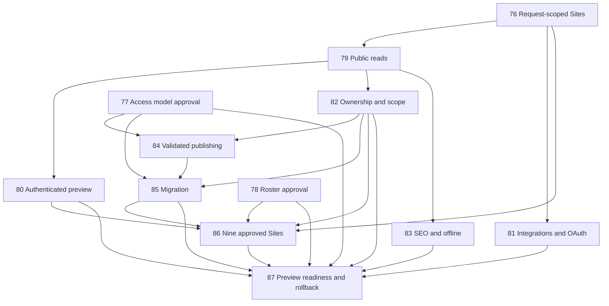

# Domain-aware website network specification

## Superseding maintainer roster decision

During this session the maintainer approved **nine Sites**, superseding the
original eight-site count in epic #75 and issue #78. There are no aliases:
`national` → `fusionparty.org.au`; `vic`, `nsw`, `sa`, `qld`, `tas`, `wa`, `nt`,
and `act` → their matching `<siteId>.fusionparty.org.au` hostnames. National has
no `branchId`. The remaining Sites associate with their corresponding branches.
This records the decision only; it does not activate additional production hosts
or approve content, CMS migration, DNS changes or deployment. The refreshed issue bodies below retain any remaining stale wording, with the
approved nine-Site decision taking precedence.

Source: live GitHub epic #75 and child issues #76–#87 fetched 2026-10-11. This file is an implementation specification, not evidence that any criterion has passed.

## Delivery boundary

Existing VIC `production` and QLD `qld` sources remain unchanged until separately reviewed migration and cutover. No production deployment, DNS changes, destructive migration, or live CMS read switch. National hostname is inactive until approved content is ready. Nine-Site completion depends on the approved roster in #78, unresolved account/gateway evidence under #77, editorial ownership mapping, and approved National/remaining-site content.

## Updated staged-delivery direction

The maintainer approved keeping separate datasets for now, fixture-only shared
model/migration work, and investigation of restricted-gateway feasibility. The
[recorded #77 policy](https://github.com/Fusion-Party-Aus/reclaim-website/issues/77#issuecomment-6108198712)
requires one authoritative gateway for future routine Studio, Signal and migration
writes. Only named break-glass technical maintainers may bypass validation for
service recovery, with audit and post-action review. Actual plan/roles/token
permissions and a working editor workflow remain unverified. No paid plan or live
consolidation is approved.

The user reports a separate `branch-agnostic-test` Worker, planned NSW/SA/NT/ACT
domains and production branch `redesign/brand-direction`. These facts do not
supply new-Site CMS sources, presentation data or content, and do not prove
Worker configuration or DNS readiness. Verify the candidate target and bindings
before any external test deployment; preserve current VIC/QLD resources.

## Dependency graph



## Deterministic runtime contract

```text
FUNCTION ResolveSite(hostname: String, deployment: Deployment, registry: SiteRegistry) -> Site OR HttpError
  host := ParseAndNormalizeHostname(hostname)
  IF host is invalid THEN RETURN HttpError(404)
  IF deployment.mode = production THEN
    IF registry contains approved active host THEN RETURN registry.siteFor(host)
    ELSE RETURN HttpError(404)
  ELSE IF deployment.mode is configured development OR shared-preview THEN
    IF deployment.siteId is missing OR unknown THEN RAISE ConfigurationError
    RETURN registry.siteById(deployment.siteId)
  ELSE RETURN HttpError(404)
END FUNCTION

FUNCTION CreateRequestContext(site: Site, adapterFactory: AdapterFactory) -> ImmutableSiteContext
  adapter := adapterFactory(site.cmsSource, perspective = published)
  content := BindContentMethods(site, adapter)
  RETURN DeepFreeze({site, content})
END FUNCTION

FUNCTION ReadPublished(site: Site, query: ContentQuery) -> ContentResult
  result := adapterFor(site.cmsSource).fetch(query)
  IF site.cmsSource.mode = legacy-dataset THEN RETURN result using legacy behavior
  scoped := only published documents whose explicit siteIds includes site.siteId
  FOR EACH document IN scoped
    IF any required reference is not published and scoped to site.siteId THEN omit document
    ELSE omit unavailable optional references
  END FOR
  RETURN scoped
END FUNCTION

FUNCTION ValidatePublication(change: Change, registry: SiteRegistry, documents: Documents) -> ValidationResult
  IF change remains draft THEN RETURN allowIncompleteDraft
  REQUIRE explicit valid owner
  REQUIRE nonempty siteIds, each present in registry
  IF singleton THEN REQUIRE exactly one siteId
  FOR EACH required reference IN changed parent
    REQUIRE published child available on every siteId of parent
  END FOR
  IF child is deleted, unpublished, or narrowed THEN
    FOR EACH published parent referencing child as required
      REQUIRE resulting child remains available on every siteId of parent
    END FOR
  END IF
  RETURN valid OR explicit violations
END FUNCTION

FUNCTION BuildMigration(sources: SourceDatasets, approvedOwners: OwnerMap, approvedSharing: ScopeMap) -> MigrationPlan
  FOR EACH source document IN deterministic source-and-id order
    REQUIRE reviewed explicit owner; otherwise add unresolved ownership and block readiness
    destinationId := deterministic namespace preserving source identity
    scope := approvedSharing[id] OR explicit original siteId
    rewrite all internal references using complete source-to-destination ID map
    validate through authoritative publication module
    add idempotent destination mutation
  END FOR
  RETURN mutations plus reconciliation counts, IDs, references, assets, owners, scopes, unresolved entries
END FUNCTION
```

## Required test seams and release evidence

Use fake Sanity adapters at the external boundary while exercising the production Site/content/validation modules. Overlap real Astro requests using VIC and QLD hosts and identical slugs. Assert visible identity, selected dataset, canonical URLs, integrations, feeds, required/optional references and cache keys remain isolated. Test unknown production hosts and production override rejection. Verify desktop/mobile pages together, cold navigation, direct interaction and keyboard paths. Public perspective is always published; draft preview must have a supported validated handshake and signed, short-lived, Site/session-bound cookie. OAuth state must be random, expiring, single-use and Site/browser-bound before code exchange. Run both site configuration/build checks, typechecking, focused tests, then full suite. Capture quota/account evidence, migration reconciliation, backup location and demonstrated preview rollback before proposing any production cutover.

## Exact child issue scope and acceptance snapshot

Refreshed from live GitHub after the maintainer update on 11 October 2026. #75 and #78 now explicitly specify nine Sites. #86/#87 still contain eight-Site wording; the recorded #78 decision supersedes that count. All fetched issues remain open; checked acceptance boxes in #78 record a completed decision, not production activation.

### #76: Refactor runtime selection to request-scoped Sites

Source: https://github.com/Fusion-Party-Aus/reclaim-website/issues/76
Status at fetch: open; updated: 2026-10-11T06:29:15Z; labels: ready-for-agent.

#### Parent

#75

#### What to build

Refactor the current build-time branch selection into a first-class Site configuration and request-scoped runtime for VIC and QLD, while they continue reading their existing Sanity datasets. Site owns `siteId`, hostnames, canonical origin, branding, navigation, features, CMS source, and optional `branchId`; Branch remains organisational identity; Worker bindings, secrets, and environment settings belong to separate Deployment configuration.

Resolve each request to an immutable `Astro.locals.siteContext` containing the resolved Site and content methods already bound to that Site. The public homepage shell must demonstrate the selected VIC or QLD identity without mutating shared process state. A production request resolves only a registered host and returns 404 for an unknown host. Explicit `SITE_ID` selection is allowed only in configured development/shared-preview environments; missing or invalid values are clear configuration errors, and the override never bypasses production host validation. National may be represented by the model later, but no unapproved National production hostname is activated here.

#### Problem Statement

The current `DEPLOYMENT` and Sanity client are selected at module import/build time, so one Worker cannot safely serve multiple Site identities. The current branch manifest also combines public Site settings with Branch identity and deployment settings. Mutating a global active deployment per request would allow concurrent requests to leak identity or content.

#### Solution

Introduce a first-class Site registry and a pure, fail-closed host resolver. Add immutable request context in Astro middleware, bind the initial VIC/QLD content interface to each Site's existing dataset, and convert the homepage shell to consume that context. Keep Deployment configuration separate and require explicit non-production Site selection.

#### Commits

1. Add distinct Site, Branch, and Deployment configuration shapes; move the existing VIC and QLD site settings into first-class Site entries without changing their current rendered output.
2. Add manifest validation for stable Site IDs, optional Branch association, unique canonical/alias hostnames, CMS source selection, and Deployment separation; keep the configuration tests passing.
3. Add a pure host-to-Site resolver and tests for canonical hosts, aliases, unknown hosts, and explicit non-production `SITE_ID` selection.
4. Add Astro request middleware and typed `locals.siteContext`; return 404 for unknown production hosts and clear configuration errors for missing/invalid non-production selection.
5. Bind the initial content methods to the resolved Site's existing VIC or QLD dataset; keep the raw Sanity client internal and avoid mutable process-wide active Site state.
6. Convert the homepage shell, base presentation, and navigation to the request context so a request visibly renders the correct Site; leave other routes for the following content-interface slice.
7. Update local/preview commands and CI branch verification to select `SITE_ID` explicitly instead of relying on the implicit VIC default.
8. Add overlapping Astro request tests for VIC and QLD proving identity and bound dataset selection remain isolated; run the existing configuration and build checks for both.

#### Decision Document

- Site, Branch, and Deployment are separate concepts and configuration sources.
- Each Site has a stable `siteId`, one canonical hostname, and approved aliases; a Site has zero or one `branchId`, while a Branch can have zero or many Sites.
- Incoming hosts are matched only against the configured registry. Unknown production hosts fail with 404.
- `SITE_ID` is an explicit override only in configured development/shared-preview environments.
- The request context is immutable and owns the Site-bound content interface. No global active Site or raw Sanity client is exposed to route callers.
- VIC and QLD keep their existing datasets in this slice. National's production hostname remains inactive until shared content is ready.

#### Testing Decisions

- Test observable behavior through the Site resolver and Astro request context, not private implementation details.
- Cover canonical hosts, aliases, unknown hosts, missing/invalid `SITE_ID`, and production rejection of the override.
- Use a fake Sanity adapter at the external boundary and exercise the production Site-bound interface.
- Overlap VIC and QLD requests and assert the rendered identity and selected dataset do not cross.
- Run existing per-branch configuration/build verification with explicit Site selection.

#### Out of Scope

- Converting every content route, API, feed, or sitemap to the Site-bound interface.
- Shared-dataset schemas, publication scopes, ownership validation, migration, or National content.
- Authenticated draft preview, OAuth state/session changes, PWA/SEO output conversion, production DNS changes, and production cutover.

#### Acceptance criteria

- [ ] Site configuration is the source of truth for Site identity and is distinct from Branch and Deployment configuration.
- [ ] VIC and QLD canonical hosts and aliases resolve to immutable request contexts bound to their existing datasets.
- [ ] Unknown production hosts return 404; production cannot be selected or bypassed with `SITE_ID`.
- [ ] Local development/shared previews require an explicit valid `SITE_ID`.
- [ ] Concurrent VIC/QLD requests render the correct homepage identity and cannot change one another's Site or dataset.
- [ ] Existing configuration/build verification passes for VIC and QLD.

#### Blocked by

None - can start immediately.

### #77: Approve Sanity shared-dataset writer access model

Source: https://github.com/Fusion-Party-Aus/reclaim-website/issues/77
Status at fetch: open; updated: 2026-10-11T10:44:24Z; labels: ready-for-human.

#### Parent

#75

#### What to build

Review the actual Sanity plan/account and approve a shared-dataset access model for routine editors and all supported publishing paths. The model must let Studio, Signal, and migration scripts apply the same authoritative ownership, publication-scope, and required-reference validation. Privileged administrators are an explicit exception. Do not assume Studio filtering is access control or introduce paid infrastructure without approval.

#### Acceptance criteria

- [ ] The current plan's roles and controls are checked against routine branch editing, publishing, Signal writes, and migration writes.
- [ ] It is established whether routine writers can be restricted to the authoritative validation path and whether branch ownership requirements can be met.
- [ ] Any concrete plan limitation is documented with viable options and their operational/security consequences.
- [ ] No paid infrastructure or weakened validation is selected implicitly.
- [ ] A maintainer records the approved access model before shared-dataset cutover.

#### Blocked by

None - can start immediately.

### #78: Record approved nine-site production hostname roster

Source: https://github.com/Fusion-Party-Aus/reclaim-website/issues/78
Status at fetch: open; updated: 2026-10-11T10:44:50Z; labels: ready-for-human.

#### Parent

#75

#### Decision

The maintainer-approved production roster contains nine Sites, with no aliases. Existing VIC and QLD production hosts remain active. National and the other six branch hosts must remain inactive until content and preview checks are complete.

| siteId     | Canonical hostname       | Aliases | branchId | Production status                                       |
| ---------- | ------------------------ | ------- | -------- | ------------------------------------------------------- |
| `national` | `fusionparty.org.au`     | None    | None     | Inactive until National content and preview checks pass |
| `vic`      | `vic.fusionparty.org.au` | None    | `vic`    | Existing active host                                    |
| `nsw`      | `nsw.fusionparty.org.au` | None    | `nsw`    | Inactive pending content and preview                    |
| `sa`       | `sa.fusionparty.org.au`  | None    | `sa`     | Inactive pending content and preview                    |
| `qld`      | `qld.fusionparty.org.au` | None    | `qld`    | Existing active host                                    |
| `tas`      | `tas.fusionparty.org.au` | None    | `tas`    | Inactive pending content and preview                    |
| `wa`       | `wa.fusionparty.org.au`  | None    | `wa`     | Inactive pending content and preview                    |
| `nt`       | `nt.fusionparty.org.au`  | None    | `nt`     | Inactive pending content and preview                    |
| `act`      | `act.fusionparty.org.au` | None    | `act`    | Inactive pending content and preview                    |

#### Acceptance criteria

- [x] The approved roster contains exactly nine Sites with unique, stable `siteId` values.
- [x] Every Site has one canonical hostname and an explicit list of zero aliases.
- [x] Every hostname maps to exactly one Site; aliases are not treated as separate Sites.
- [x] Each Site has zero or one approved `branchId`; National has none.
- [x] The roster records which production hostnames must remain inactive until content is ready.
- [x] Maintainer approval of the roster is recorded.

#### Blocked by

None - roster decision complete. Production activation remains gated by preview and content readiness.

### #79: Route public reads through the Site-bound content interface

Source: https://github.com/Fusion-Party-Aus/reclaim-website/issues/79
Status at fetch: open; updated: 2026-10-11T06:29:40Z; labels: ready-for-agent.

#### Parent

#75

#### What to build

Move all public Sanity reads behind the request's site-bound `content` interface. Convert page routes, components, APIs, feeds and reference lookups so callers use content methods already bound to `siteId` and the Site's configured CMS source. Keep the raw Sanity client internal. Initially VIC and QLD continue using their existing datasets; shared-dataset filtering is a later slice.

The interface must cover list and slug lookups, nested/reference reads and feeds. Include `siteId` in every Site-specific cache key. Replace the test that mocks its own Sanity client with tests that exercise the production content module through a fake Sanity adapter.

#### Acceptance criteria

- [ ] Public routes and components do not import or use the module-global Sanity client directly.
- [ ] `content` methods require no caller-supplied `siteId`; they select the dataset/client from the resolved Site context.
- [ ] VIC and QLD content reads stay on their existing datasets and preserve current public behavior.
- [ ] Overlapping VIC/QLD requests with an identical slug return only the content for the request's Site.
- [ ] Lists, slug lookups, nested references, and feeds use the Site-bound interface.
- [ ] Site-specific cache keys include `siteId`; concurrent requests cannot reuse another Site's content.
- [ ] Tests exercise the production module with a fake Sanity adapter, including same-slug isolation.

#### Blocked by

- #76 Refactor runtime selection to request-scoped Sites

### #80: Separate authenticated preview from public content

Source: https://github.com/Fusion-Party-Aus/reclaim-website/issues/80
Status at fetch: open; updated: 2026-10-11T06:30:04Z; labels: ready-for-agent.

#### Parent

#75

#### What to build

Separate authenticated draft preview from public content. Public requests always use the published perspective. A distinct preview content interface may read drafts only after the server validates a supported Sanity Presentation/preview handshake; an incoming request or Studio Origin header alone is not proof of authentication.

Issue a signed, short-lived preview session bound to `siteId` and carry it in a Secure, HttpOnly cookie. Keep Sanity read credentials server-side. Preview responses must be private/no-store, non-indexable, and excluded from service-worker caches. Validate return URLs and provide an explicit Exit Preview action. Remove the build-time visual-editing flag's ability to put the shared public client into draft perspective.

#### Acceptance criteria

- [ ] Public content requests always use published data regardless of build environment or preview configuration.
- [ ] Preview session issuance requires the documented supported Sanity handshake; Origin-only or arbitrary requests cannot issue a session.
- [ ] Preview sessions are signed, short-lived, bound to `siteId`, and stored in a Secure, HttpOnly cookie.
- [ ] Draft access and server-side read credentials are available only through the separate preview interface.
- [ ] Preview responses are private/no-store, noindex, and excluded from service-worker caches.
- [ ] Return URLs are validated and an explicit Exit Preview action clears the session.
- [ ] Tests cover valid handshakes plus expired, replayed, wrong-Site and wrong-session attempts; drafts never appear in public responses or caches.

#### Blocked by

- #76 Refactor runtime selection to request-scoped Sites
- #79 Route public reads through the Site-bound content interface

### #81: Route integrations and OAuth through Site context

Source: https://github.com/Fusion-Party-Aus/reclaim-website/issues/81
Status at fetch: open; updated: 2026-10-11T06:31:47Z; labels: ready-for-agent.

#### Parent

#75

#### What to build

Make newsletter, membership/CRM and NationBuilder OAuth handlers resolve integration configuration from the request's Site context. Use per-Site credentials/bindings and Site-namespaced token/session keys; never infer an origin or credential from an arbitrary Host header.

For OAuth, an alias request to `/api/oauth/nationbuilder/start` redirects to the configured canonical `/start`. Canonical start creates cryptographically random, short-lived, single-use state bound to both `siteId` and the initiating browser session. Both start and callback use the configured canonical callback URL. The canonical callback validates and consumes state before exchanging the authorization code, rejecting missing, expired, replayed, wrong-Site, or wrong-session state. Ordinary page visits on aliases are not redirected.

#### Acceptance criteria

- [ ] Each handler selects the correct Site's integration settings; unset integrations fail clearly without falling back to another Site's credentials.
- [ ] Canonical start and callback URLs come only from `canonicalOrigin`.
- [ ] Alias OAuth start reaches the canonical start endpoint while ordinary alias page visits remain in place.
- [ ] State is cryptographically random, short-lived, single-use, and bound to `siteId` plus the initiating browser session.
- [ ] Callback rejects missing, expired, replayed, wrong-Site and wrong-session state before code exchange.
- [ ] Site token/session storage is namespaced and concurrent Site flows cannot overwrite one another.
- [ ] Tests cover valid flow and every listed rejection case using fakes at external boundaries.

#### Blocked by

- #76 Refactor runtime selection to request-scoped Sites

### #82: Add Site-scoped ownership and publication rules

Source: https://github.com/Fusion-Party-Aus/reclaim-website/issues/82
Status at fetch: open; updated: 2026-10-11T06:30:04Z; labels: ready-for-agent.

#### Parent

#75

#### What to build

Add the shared-dataset content model and scoped public read rules while keeping production reads on the existing VIC/QLD datasets until migration is verified. Each content document has explicit ownership:

```ts
owner:
  | { type: 'national' }
  | { type: 'branch'; branchId: string }

siteIds: string[]
```

Ownership is independent of publication scope. Published public reads require published status and membership of the current `siteId`; ownership never grants visibility. Drafts may have an empty `siteIds`; published documents need at least one valid Site. Site-specific singleton documents target exactly one Site; intentionally shared content lists every permitted Site.

Enforce Site scope across lists, slug lookups, references, nested content and feeds. A required reference must be published and available on every Site in its parent's scope. Validate on parent publication and when a child is unpublished, deleted or its scope is narrowed; drafts may remain incomplete. Public reads independently check references and fail closed for a parent with an unavailable required reference. Optional unavailable references are omitted. Ordinary hyperlinks may intentionally cross Sites.

#### Acceptance criteria

- [ ] The schema requires an explicit valid owner; missing owner is invalid and never implies National ownership.
- [ ] `siteIds` is an explicit scope; published content requires at least one valid Site, while drafts may have none.
- [ ] Site-specific singleton schemas enforce exactly one Site; shared documents require explicit IDs for every permitted Site.
- [ ] All public query methods require published status and the current Site ID, including lists, duplicate-slug lookups, references, nested projections and feeds.
- [ ] Required-reference integrity is checked on parent publication and child unpublish/delete/scope narrowing; drafts can remain incomplete.
- [ ] Public reads independently fail closed when a required reference is unavailable and omit unavailable optional references.
- [ ] Tests exercise the production content interface with fakes, including wrong/missing scope, duplicate slugs, required and optional references, and cross-Site sharing.
- [ ] Scoped reads are not enabled for existing production content until the migration has backfilled and reconciled VIC/QLD documents.

#### Blocked by

- #79 Route public reads through the Site-bound content interface

### #83: Make SEO, discovery and offline output Site-aware

Source: https://github.com/Fusion-Party-Aus/reclaim-website/issues/83
Status at fetch: open; updated: 2026-10-11T06:30:04Z; labels: ready-for-agent.

#### Parent

#75

#### What to build

Make every public URL and site-dependent discovery/offline response correct for the request's Site. Use the configured `canonicalOrigin` for canonical links, structured-data identifiers, absolute public URLs, feeds, API payloads, sitemaps, robots/AI discovery files, and IndexNow. Replace or adapt build-time integrations that assume one Astro origin.

Convert prerendered or build-selected site surfaces—including FAQ/electorate detail output where applicable, the web manifest, service worker, and brand icons—to a deliberate per-Site SSR or collision-safe delivery strategy. Site-specific service-worker caches must not cross Sites. Ordinary alias requests remain in place while emitted canonical URLs use the configured canonical origin.

#### Acceptance criteria

- [ ] Canonical URLs, JSON-LD, feeds, APIs, sitemaps, robots/AI discovery and IndexNow use the configured Site canonical origin, never an untrusted request host.
- [ ] Every public discovery endpoint queries content through the Site-bound interface.
- [ ] Manifest, service worker, brand icons, and all other site-dependent prerendered surfaces return the correct Site output.
- [ ] Service-worker/offline caches are namespaced by stable `siteId` and cannot serve another Site's identity or content.
- [ ] Host-level tests verify same-route responses for VIC and QLD have distinct correct metadata and discovery URLs.
- [ ] Production build output contains no accidental single-Site absolute origin for runtime-served Sites.

#### Blocked by

- #79 Route public reads through the Site-bound content interface

### #84: Route supported publishing paths through authoritative validation

Source: https://github.com/Fusion-Party-Aus/reclaim-website/issues/84
Status at fetch: open; updated: 2026-10-11T06:30:31Z; labels: ready-for-agent.

#### Parent

#75

#### What to build

Create one authoritative publishing-validation module and route every supported write path through it: Sanity Studio publish/unpublish/delete actions, Signal, and migration scripts. Validate explicit ownership, valid `siteIds`, singleton scope, and required-reference availability for every Site where a parent is published. Drafts may remain incomplete. Privileged administrators are an explicit exception; routine writers must not bypass the supported gateway.

Use the approved Sanity access model. If routine writers cannot be restricted to the authoritative path on the current plan, stop before shared-dataset cutover and report the concrete limitation and options; do not silently weaken validation or add paid infrastructure.

#### Acceptance criteria

- [ ] The same production validation module is called by Studio, Signal, and migration write paths.
- [ ] Parent publication rejects missing/invalid owner, empty/invalid published scope, and required references unavailable on any target Site.
- [ ] Child unpublish, delete, or scope narrowing is rejected when it would invalidate a published parent on an affected Site.
- [ ] Drafts may be incomplete; optional unavailable references do not block publication.
- [ ] Public reads still fail closed independently if invalid data is written by a privileged administrator or another unsupported path.
- [ ] Routine writer permissions are checked against the approved Sanity model; privileged administrator bypass is explicit and documented.
- [ ] Tests exercise each supported writer adapter with a fake Sanity boundary and prove no supported path bypasses shared validation.

#### Blocked by

- #77 Approve Sanity shared-dataset writer access model
- #82 Add Site-scoped ownership and publication rules

### #85: Migrate VIC and QLD data into the shared CMS

Source: https://github.com/Fusion-Party-Aus/reclaim-website/issues/85
Status at fetch: open; updated: 2026-10-11T06:31:46Z; labels: ready-for-agent.

#### Parent

#75

#### What to build

Implement a repeatable, non-destructive migration of the existing VIC and QLD datasets into the approved shared dataset. Before scoped reads are enabled, backfill each document with an explicit owner and `siteIds`. Source-dataset membership can establish the initial Site scope (VIC or QLD), but must not silently determine organisational ownership: use explicit editorial provenance or a reviewed per-document mapping. An ambiguous owner remains in the reconciliation report and blocks scoped-read/cutover approval until resolved; it must never default to National. Apply deliberate cross-Site publication only from an approved mapping. Use the shared publishing validator for all writes.

Preserve references and assets, handle cross-dataset `_id` collisions deterministically, remap references, and produce a reconciliation report. Keep both source datasets unchanged through preview verification; provide and test rollback to the old read configuration.

#### Acceptance criteria

- [ ] A backup/export of both source datasets is retained before migration writes.
- [ ] Every migrated document has an explicit owner from editorial provenance or a reviewed mapping, and an explicit initial Site scope before any shared scoped reads are enabled.
- [ ] Unresolved ownership is reported and blocks scoped-read/cutover approval; no missing owner or dataset-based implicit National owner is accepted.
- [ ] Cross-Site publication is applied only from an explicit approved mapping.
- [ ] Re-running the migration creates no duplicates and converges to the same result.
- [ ] ID collisions are handled deterministically and all internal references are remapped correctly.
- [ ] Assets and representative nested/required/optional references resolve after migration.
- [ ] A reconciliation report compares source and destination document counts, IDs, references, assets, owner and scope.
- [ ] Fixtures cover repeated runs, collisions, reference preservation, invalid scopes, and rollback.
- [ ] Source datasets remain intact; no production read switch or destructive cleanup occurs in this issue.

#### Blocked by

- #77 Approve Sanity shared-dataset writer access model
- #82 Add Site-scoped ownership and publication rules
- #84 Route supported publishing paths through authoritative validation

### #86: Add National and the remaining approved Sites

Source: https://github.com/Fusion-Party-Aus/reclaim-website/issues/86
Status at fetch: open; updated: 2026-10-11T06:30:42Z; labels: ready-for-agent.

#### Parent

#75

#### What to build

Add the approved Site records for the eight-site roster and introduce National content directly in the shared dataset. National is an ordinary Site with no `branchId`; its content has explicit `{ type: 'national' }` ownership and explicit `siteIds`. Branch-owned content retains its Branch owner. Site-specific singleton documents target exactly one Site, while intentionally shared content lists every permitted Site.

Provide preview-host routing for every approved Site, but do not activate National's production hostname until its content has passed preview verification. Do not change production DNS or perform production cutover.

#### Acceptance criteria

- [ ] The eight Site records match the maintainer-approved stable IDs, canonical hosts, aliases, and optional Branch associations exactly.
- [ ] Every configured hostname maps to exactly one Site and National has no Branch association.
- [ ] National content is authored/imported directly into the shared dataset, with explicit National ownership and explicit publication scope.
- [ ] Branch-owned content retains its Branch owner; publication to multiple Sites is explicit and does not transfer ownership.
- [ ] Site-specific singleton and shared-content scope rules are satisfied.
- [ ] Every Site renders its own navigation, contact details, branding, and content on an approved preview host.
- [ ] National production hostname remains inactive until preview content checks pass; no production DNS/deployment changes occur.

#### Blocked by

- #76 Refactor runtime selection to request-scoped Sites
- #78 Approve the eight-site production hostname roster
- #80 Separate authenticated preview from public content
- #82 Add Site-scoped ownership and publication rules
- #85 Migrate VIC and QLD data into the shared CMS

### #87: Prove preview readiness and document cutover rollback

Source: https://github.com/Fusion-Party-Aus/reclaim-website/issues/87
Status at fetch: open; updated: 2026-10-11T06:30:48Z; labels: ready-for-agent.

#### Parent

#75

#### What to build

Prove the approved eight-Site network in non-public previews before any production cutover. Verify request isolation, published and preview content scope, metadata/discovery/offline behavior, integrations, quota headroom, and the rollback procedure using actual Site and CMS data. Produce a cutover checklist and rollback criteria, but make no production deployment, DNS change, or live CMS read switch without separate approval.

#### Acceptance criteria

- [ ] All eight approved preview hosts render the expected Site identity and content with no cross-Site leaks under overlapping requests.
- [ ] Same-slug content, canonical URLs, structured data, feeds, sitemaps, robots/AI discovery, manifests, service workers and offline caches are correct per Site.
- [ ] Public and authenticated preview paths meet their separate scope, cache, indexing, and session requirements.
- [ ] Newsletter, membership/CRM and OAuth work with Site-appropriate settings; invalid OAuth state is rejected.
- [ ] Current document counts, image storage, request volume and bandwidth are measured against the selected free-tier limits, including SSR query/caching behavior.
- [ ] Migration reconciliation passes, source datasets remain available, and rollback is demonstrated in preview.
- [ ] A cutover checklist, backup/restore location, rollback criteria and unresolved limitations are documented.
- [ ] No production deployment, DNS change, destructive migration, or live CMS cutover occurs in this issue.

#### Blocked by

- #77 Approve Sanity shared-dataset writer access model
- #78 Approve the eight-site production hostname roster
- #80 Separate authenticated preview from public content
- #81 Route integrations and OAuth through Site context
- #82 Add Site-scoped ownership and publication rules
- #83 Make SEO, discovery and offline output Site-aware
- #85 Migrate VIC and QLD data into the shared CMS
- #86 Add National and the remaining approved Sites

## Later candidate landing-host approval

Following session approval, NSW/SA/NT/ACT now resolve to separate content-free
coming-soon landing contexts in the candidate, without datasets, integrations or
VIC/QLD presentation. This is not completion of #86 and does not activate National,
TAS or WA, change production DNS, or authorize live CMS consolidation.
